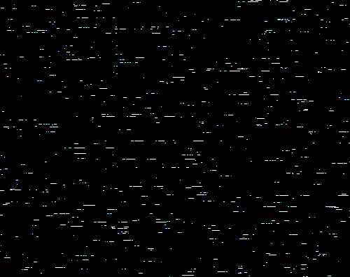
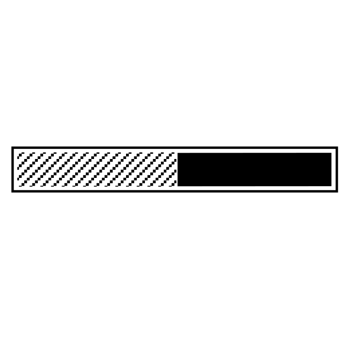

# ── 𝕿𝖍𝖊 𝖁𝖔𝖎𝖉 ──

<!-- Мрачный баннер с помехами (из твоего репозитория) -->

 

<h1><b>A completely broken person.</b></h1>
<h1><b>No feelings, nothing, a mental disorder.</b></h1>
<h1><b>Just a terrible person.</b></h1>

 

  

<table bgcolor="#0d1117" width="100%" border="0" cellspacing="0" cellpadding="0">
<tr>
<td align="center">
<h2><b>This happens almost every day. Every damn day I remember it and realize that I couldn’t have done anything because I was weak.</b></h2>
 
<h2><b>This fucking happens every damn day.</b></h2>
 
<h2><b>Every time I realize that no matter what I do, I won’t be able to fix it; all I can do is rot and then burn.</b></h2>
</td>
</tr>
</table>

  

<!-- Финальная линия статического шума -->

